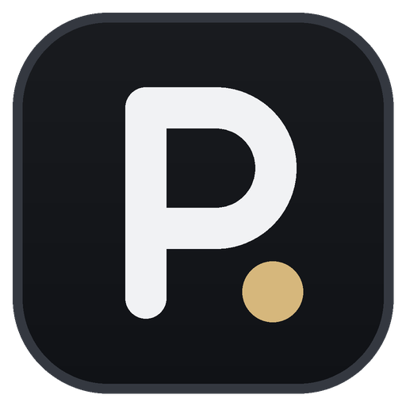

<div align="center">



# Plunder Count

**Counts every chest you open in Fortnite, match after match, with a dark glass HUD over the game.**

[**Download PlunderCount.exe**](../../releases/latest) · Windows 10 / 11 · free · no install

</div>

---

Plunder Count reads the replays Fortnite saves after each match and keeps a running count of the chests you opened, plus the **treasure hunt treasures** you got from them. A glass overlay shows your figures over the game, and a report keeps your whole history.

> It counts the chests **you** opened. It does not show where chests are on the map.

## Why it's safe

- **Only reads replay files** in `%LOCALAPPDATA%\FortniteGame\Saved\Demos`, read only, never modified or deleted.
- **No game modification** and **no access to the game's memory**. It never touches the Fortnite process.
- **No data sent.** No Epic login, no telemetry. The only network access is the update check on this repo's GitHub releases (can be turned off).

> [!IMPORTANT]
> **Turn on replays in Fortnite**: *Settings → Game → Replays → Record Replays: **On***. No replays, nothing to count.

Fortnite only writes a replay's decryption key when the match ends, so chests are counted **a few seconds after each match**. While you play, the overlay shows **● In a match**.

## Getting started

1. Download **[`PlunderCount.exe`](../../releases/latest)**.
2. Turn on replays in Fortnite.
3. Run it. *"Windows protected your PC"* shows because the exe isn't signed: *More info → Run anyway*.
4. The short setup checks your replays folder, offers to count the replays already on your PC, and asks about the overlay and opening with Fortnite.
5. Keep it open while you play. Minimized, it sits in the notification area next to the clock.

## The overlay

Two styles, switch in **Settings → Overlay style**:

- **Glass panel** (default): a dark, see-through card with your total, the current or last match, your session and treasures.
- **Minimal**: only the figures with a slim accent bar, no background. Put it under the minimap.

| Shortcut | What it does |
|---|---|
| **Ctrl+Shift+O** | Show / hide the overlay, even in game. |
| **Ctrl+Shift+L** | Lock / unlock. Locked: the mouse goes through it. Unlocked: drag to move, right-click to hide. |

Set Fortnite to **Windowed Fullscreen** (*Settings → Video → Window Mode*) so the overlay can draw on top. Streaming? `overlay.html` is a transparent overlay for an **OBS** browser source.

## The report

`report.html` opens in your browser and refreshes itself: total, average, best match, chests per day, chest types, treasures and every match.

## Your data

Stored in `%APPDATA%\PlunderCount` (**Help → Open the data folder**): `report.html`, `overlay.html`, `matches.csv`, `data.json` (your whole history, back it up), `config.json`, `errors.log`. If you used the original Chest Counter before, its data is picked up automatically on first launch.

## Command line options

```
PlunderCount.exe --demos <folder>    another replays folder
PlunderCount.exe --data <folder>     another data folder
PlunderCount.exe --once              analyze the finished replays, then quit
PlunderCount.exe --reset-config      run the setup again
PlunderCount.exe --overlay-preview <file.png>   save previews of the overlay, then quit
```

## Build it yourself

Install the [.NET 10 SDK](https://dotnet.microsoft.com/download/dotnet/10.0) (Windows x64) and run **`build.bat`**: the exe lands in `dist\PlunderCount.exe`. GitHub Actions builds it on every push and attaches it to a release when a `v*` tag is pushed.

## License and credits

[MIT](LICENSE). Plunder Count is a customized fork of [Fortnite Chest Counter](https://github.com/LED-N/Fortnite-ChestCounter) by LED-N (MIT), with counting fixes by koiseka. Replay reading is based on [FortniteReplayDecompressor](https://github.com/Shiqan/FortniteReplayDecompressor) by Shiqan (MIT), see [`lib/PATCHES.md`](lib/PATCHES.md).

Not affiliated with, endorsed or sponsored by Epic Games. Fortnite is a trademark of Epic Games, Inc.
